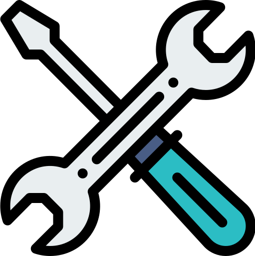

<h1 align="center">
  
  ПрофЭлита
</h1>

<p align="center">
  <strong>Частные мастера в твоём городе</strong>
</p>

ПрофЭлита — сайт для поиска частных мастеров и заказа бытовых услуг в разных городах. В проекте представлены мастера по сантехнике и электрике, их услуги, цены и отзывы. Посетители могут заказать звонок, консультацию или услугу, оставить отзыв и заявку на сотрудничество.

Сайт включает страницы городов, мастеров и услуг, информационные разделы и административную панель для управления мастерами. Для динамических страниц формируются отдельные URL, SEO-теги и XML-карты сайта.

## Стек технологий

| Компонент | Технологии |
| --- | --- |
| Backend | PHP 8.2 в Docker, Laravel 10, Eloquent ORM |
| База данных | MySQL 8.0 |
| Frontend | Blade, Bootstrap, jQuery, готовые CSS/JS в `public/` |
| Сборка ресурсов | Vite 4, Laravel Vite Plugin |
| Веб-сервер | Nginx + PHP-FPM |
| Локальное окружение | Docker Compose, Composer, Xdebug |
| Проверка кода | PHPUnit 10, Laravel Pint |
| Формы обратной связи | Laravel Mail, Google reCAPTCHA v3 |

Код использует `readonly class`, поэтому для запуска вне Docker нужен PHP **8.2 или новее**, хотя в `composer.json` пока указан минимум 8.1. Кэш и сессии по умолчанию хранятся в файлах. Письма отправляются синхронно; отдельный обработчик очереди пока не требуется.

## Структура проекта

```text
├── app/
│   ├── Console/Commands/       Artisan-команды для пользователей, услуг, URL и sitemap
│   ├── Http/
│   │   ├── Controllers/       Контроллеры сайта, форм и административной панели
│   │   ├── Middleware/        Авторизация и проверка доступа администратора
│   │   └── Requests/          Валидация входящих запросов
│   ├── Mail/                  Письма из форм обратной связи
│   ├── Models/                Модели Eloquent
│   ├── Providers/             Регистрация сервисов и зависимостей
│   ├── Repositories/          Работа с данными и интерфейсы репозиториев
│   └── Services/              Бизнес-логика
│       ├── PageDataProvider/  Стратегии данных страниц городов, мастеров и услуг
│       ├── PageSessionData/   Стратегии данных сессии и DTO
│       └── Seo/               Формирование SEO-тегов
├── bootstrap/                 Загрузка приложения
├── config/                    Настройки Laravel, сайта, почты и SEO
├── database/
│   ├── factories/             Фабрики тестовых данных
│   ├── migrations/            Миграции схемы базы данных
│   └── seeders/               Начальные данные
├── docker/                    Compose, PHP, Nginx и дамп MySQL
├── public/                    Точка входа, стили, скрипты и изображения
├── resources/                 Blade-шаблоны и исходники ресурсов для Vite
├── routes/                    Веб-маршруты, API и консольные маршруты
├── storage/                   Загруженные файлы, логи, кэш и сессии
├── tests/                     Unit- и Feature-тесты
├── .env.example               Шаблон настроек приложения
├── artisan                    Консоль Laravel
└── vite.config.js             Настройки сборки ресурсов
```

Контроллеры обращаются к сервисам, а сервисы используют репозитории для доступа к данным. Данные динамической страницы выбираются через `PageDataProviderFactory` и отдельные стратегии по типу записи в таблице `urls`. Зависимости регистрируются в service providers и передаются через контейнер Laravel.

## Локальный запуск через Docker

Нужны Docker Engine и Docker Compose v2. PHP, Composer, Nginx и MySQL запускаются в контейнерах. Все команды ниже выполняются из корня проекта.

### 1. Подготовить окружение

При первом запуске скопируйте шаблоны:

```bash
cp .env.example .env
cp docker/.env.example docker/.env
```

В `.env` задайте настройки приложения и базы:

```dotenv
APP_NAME="ПрофЭлита"
APP_ENV=local
APP_DEBUG=true
APP_URL=http://localhost:3000
LOCALE=ru

DB_CONNECTION=mysql
DB_HOST=db
DB_PORT=3306
DB_DATABASE=profelita
DB_USERNAME=root
DB_PASSWORD=your-local-password
```

В `docker/.env` задайте такой же пароль в `MYSQL_ROOT_PASSWORD`. Значение `UID` должно совпадать с UID вашего пользователя на Linux; его можно узнать командой `id -u`.

### 2. Запустить контейнеры

```bash
docker compose --env-file docker/.env -f docker/docker-compose.yaml up -d --build
```

При создании нового тома `mysql_data` MySQL автоматически импортирует `docker/mysql/dump.sql`. Дамп содержит данные сайта и историю миграций. При последующих запусках импорт не повторяется.

### 3. Установить зависимости и подготовить приложение

```bash
docker compose --env-file docker/.env -f docker/docker-compose.yaml exec php composer install
docker compose --env-file docker/.env -f docker/docker-compose.yaml exec php php artisan key:generate
docker compose --env-file docker/.env -f docker/docker-compose.yaml exec php php artisan migrate
docker compose --env-file docker/.env -f docker/docker-compose.yaml exec php php artisan storage:link
```

Ключ приложения создаётся при первом запуске. Миграции применяют изменения схемы, добавленные после создания дампа. Выполнять `db:seed` поверх импортированного дампа для обычного запуска не нужно.

Фотографии и другие загруженные файлы не восстанавливаются из SQL-дампа: при необходимости их нужно отдельно скопировать в `storage/app/public/`, сохранив пути из базы. Каталоги `storage/` и `bootstrap/cache/` должны быть доступны PHP-процессу для записи.

### 4. Открыть сайт

| Назначение | Адрес |
| --- | --- |
| Сайт | http://localhost:3000 |
| Вход | http://localhost:3000/enter |
| Административная панель | http://localhost:3000/admin |
| MySQL с компьютера | `127.0.0.1:3306` |
| MySQL из PHP-контейнера | `db:3306` |

Порты `3000` и `3306` должны быть свободны. Для изменения портов отредактируйте `ports` в `docker/docker-compose.yaml`; при смене порта сайта обновите `APP_URL`. Внутренний порт MySQL в `DB_PORT` остаётся `3306`.

### Создание администратора

```bash
docker compose --env-file docker/.env -f docker/docker-compose.yaml exec php php artisan app:user-create "Администратор" admin@example.test 1 "your-password"
```

Параметры команды: имя, email, признак администратора (`1` или `0`), пароль. После создания пользователя можно войти через `/enter`.

## Настройки сайта и форм

Основные параметры находятся в `.env`, а значения по умолчанию — в конфигурационных файлах:

| Параметр | Назначение |
| --- | --- |
| `APP_URL` | Адрес сайта, в том числе для генерации sitemap и ссылок на файлы |
| `LOCALE` | Локаль приложения, например `ru` |
| `APP_MAIN_CITY_CODE` | Код города главной страницы; по умолчанию `msk` |
| `APP_MAIN_CITY_NAME` | Название основного города; по умолчанию `Москва` |
| `APP_DEFAULT_ADDRESS` | Адрес для страниц сайта |
| `SITE_NAME`, `SITE_SLOGAN` | Название и слоган |
| `MAIL_MAILER`, `MAIL_HOST`, `MAIL_PORT` | Способ отправки почты и SMTP-сервер |
| `MAIL_USERNAME`, `MAIL_PASSWORD`, `MAIL_ENCRYPTION` | Доступ к SMTP и шифрование |
| `MAIL_FROM_ADDRESS`, `MAIL_FROM_NAME` | Отправитель писем |
| `MAIL_TO_ADDRESS` | Получатель заявок из форм |
| `RECAPTCHA_CODE`, `RECAPTCHA_SECRET` | Публичный и секретный ключи Google reCAPTCHA v3 |

Некоторые параметры отсутствуют в `.env.example` — добавьте их в `.env` при настройке соответствующей функции. Для главной страницы в базе должны существовать город с кодом `APP_MAIN_CITY_CODE` и его запись в `urls`.

В Docker Compose нет почтового сервера Mailpit, хотя он указан в шаблоне `.env`. Для локальной записи писем в лог установите `MAIL_MAILER=log` и `MAIL_TO_ADDRESS=dev@example.test`. Для реальной отправки настройте доступный SMTP-сервер. Проверка reCAPTCHA выполняется и при использовании почтового логирования; ключи должны разрешать используемый домен.

SEO-тексты находятся в `config/seo.php`, темы писем — в `config/services.php` → `mailer.subjects`. После изменения `.env` сбросьте кэш конфигурации:

```bash
docker compose --env-file docker/.env -f docker/docker-compose.yaml exec php php artisan config:clear
```

## Frontend

Текущие Blade-шаблоны подключают готовые стили и скрипты из `public/css`, `public/js` и `public/assets`. Для их использования запуск Vite не требуется.

Для работы с исходниками `resources/css/app.css` и `resources/js/app.js` установите Node.js, совместимый с Vite 4, и npm. Node.js в PHP-контейнере не установлен; команды выполняются на компьютере:

```bash
npm install
npm run dev
```

Сборка ресурсов:

```bash
npm run build
```

Проверка получения токенов reCAPTCHA и отправки форм (Node.js, без установки npm-зависимостей):

```bash
npm run test:forms
```

Результат сборки находится в `public/build/`. Для использования этой сборки в Blade необходимо подключение через `@vite`; в текущих шаблонах его нет.

## Консольные команды

В Docker запускайте команды с префиксом:

```bash
docker compose --env-file docker/.env -f docker/docker-compose.yaml exec php php artisan <команда>
```

| Команда Artisan | Назначение |
| --- | --- |
| `app:user-create {name} {email} {is_admin} {password}` | Создать пользователя |
| `app:fill-services-master {master_id}` | Добавить услуги мастеру по шаблонам |
| `app:fill-services-template {service_template_id}` | Добавить услуги по новому шаблону |
| `app:url-generating-city {city_id}` | Создать URL города |
| `app:url-generating-master {master_id}` | Создать URL мастера и его услуг |
| `app:sitemap-generating-city {city_id}` | Сформировать sitemap города |
| `app:sitemap-generating-master {master_id}` | Сформировать sitemap мастера и его услуг |

Параметры в фигурных скобках заменяются реальными значениями. Для нового мастера сначала добавьте услуги, затем создайте URL, после этого генерируйте sitemap.

Карты `sitemap_city_{city_id}.xml` и `sitemap_master_{master_id}.xml` записываются в корень проекта. Публикация этих файлов и включение их в общую карту сайта выполняются отдельно: Nginx раздаёт только каталог `public/`.

Подробнее: [документация консольных команд](app/Console/Commands/README.md).

## Команды разработки

```bash
# Состояние контейнеров
docker compose --env-file docker/.env -f docker/docker-compose.yaml ps

# Логи контейнеров
docker compose --env-file docker/.env -f docker/docker-compose.yaml logs -f php nginx

# Список маршрутов
docker compose --env-file docker/.env -f docker/docker-compose.yaml exec php php artisan route:list

# Сброс кэшей приложения
docker compose --env-file docker/.env -f docker/docker-compose.yaml exec php php artisan optimize:clear

# Тесты
docker compose --env-file docker/.env -f docker/docker-compose.yaml exec php php artisan test

# Проверка стиля без изменения файлов
docker compose --env-file docker/.env -f docker/docker-compose.yaml exec php vendor/bin/pint --test

# Остановка окружения с сохранением базы
docker compose --env-file docker/.env -f docker/docker-compose.yaml down
```

Тесты генераторов используют SQLite в памяти и требуют расширения `pdo_sqlite`. Проверка главной страницы в `ExampleTest` использует базу из окружения и требует подготовленных данных сайта. Настройки PHPUnit находятся в `phpunit.xml`.

Логи Laravel по умолчанию находятся в `storage/logs/laravel.log`. Xdebug в Docker включается по триггеру: через Xdebug Helper или параметр `XDEBUG_TRIGGER=1` в URL. Для настройки IDE и деталей окружения см. [docker/README.md](docker/README.md).

## Особенности окружения

- Том `mysql_data` сохраняет базу между перезапусками. Команда `down -v` удаляет том вместе с данными; используйте её только для намеренного сброса локальной базы.
- Изменение `MYSQL_ROOT_PASSWORD` в `docker/.env` не меняет пароль в уже инициализированной базе.
- При `APP_ENV=local` или `testing` внешние счётчики аналитики и виджет Jivo не подключаются.
- Корнем веб-сервера должен быть `public/`. Для рабочего окружения задайте `APP_ENV=production`, `APP_DEBUG=false`, реальный `APP_URL` и настройки почты.
